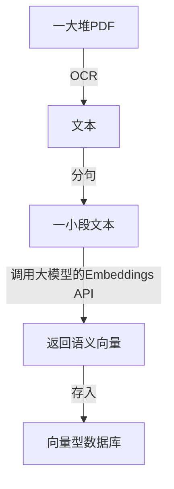
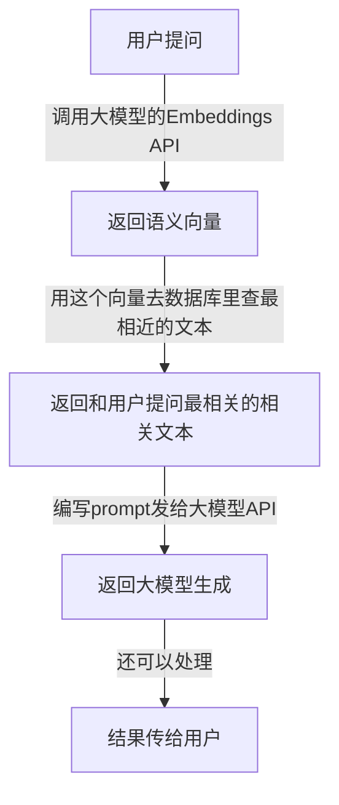

从我们熟悉的传统的异步后端流水线来切入，了解一下现在很多业务团队在做的RAG吧。
# RAG（Retrieval-Augmented Generation，检索增强生成）
很多法律相关的电商相关的，比如有这种业务，你需要根据平台的版权规则或者法律条文，让ai根据这些条文给用户返回。因为大模型(llm)的数据本身训练的时候可能已经很久之前了，而且是通用的，容易胡说八道，需要你手动喂给他一些东西，再让他输出，可能会准一点。他的流程大体是这样的。
## 业务流
实际上这个业务流是可以很灵活的，至于为什么业务要这么设计我就不讲了，绝大部分的业务团队和开源项目Langchain这种的，整体上都基本上是这么个模式。
### 上传业务内容

这里最困难的很显然实是预处理输入，分句和OCR出文本的地方。怎么根据业务和资源去调整数据清洗的部分很难。
### 用户请求

这里相比之下看起来就简单一点，比较需要注意的，用户可能会prompt注入，需要进行输入清洗处理。
## 技术栈
web后端：其实啥后端都能用不过追求并发量，最好用fastapi这种异步支持的比较好的
redis：消息队列
异步流水线：[taskiq](https://taskiq-python.github.io/)/[celery](https://docs.celeryq.dev/en/stable/)这里处理绝大部分业务内容。
向量型数据库：[Qdrant](https://qdrant.tech/)，其实就是普通数据库，只不过本来的数据库可能是通过key来一条记录一条记录的机械匹配查找，但是这个给值分配的key是一个向量，然后比如可以通过另一个向量把离这个向量最近的一个或者一批给查出来。
### 开源RAG框架
很多小团队会使用这个来快速上线
[LangChain](https://github.com/langchain-ai/langchain)
## 其他
有没有发现RAG工程其实和AI半毛钱关系都没有，本质上就是个传统的异步后端流水线，只不过对接的api是大模型而已。有了大模型我们的业务就不是正则匹配这种很机械的搜索了，可以支持模糊匹配，再用大模型把从数据库里匹配到的一大堆语句，根据客户需求整理起来。
这个业务里最困难最困难的，绝对是对不规则的pdf进行数据清理，如果pdf里有表格，可能还有页眉，页码这种噪音干扰，还有语句切分。

